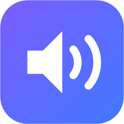
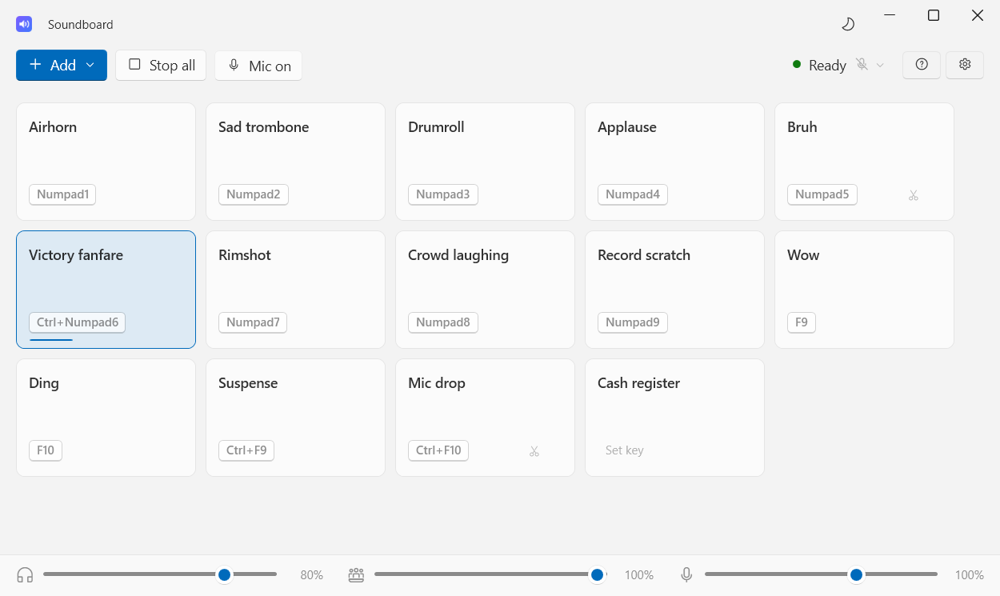
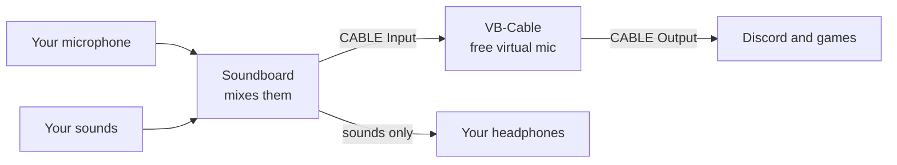

# Soundboard

**Play sounds into your mic for Discord and games, with one key.**

A free soundboard for Windows 10 and 11. Your friends hear the sound mixed with your voice, 
and you hear it in your headphones.

 

[-3b82f6)](#requirements)

 

<picture>
  <source media="(prefers-color-scheme: dark)" srcset=".github/images/main-dark.png">
  
</picture>

 

## What it does

- 🎹 **One key, anywhere.** Give each sound a key or a combination (Numpad, F-keys, Ctrl+…). It plays from anywhere, even inside a game, and the key still works normally there.
- 🎙️ **Into your mic and your ears.** Others hear the sound together with your voice. You hear it in your headphones, at your own volume.
- 📥 **Add sounds in seconds.** Drop in mp3, wav, ogg or flac files, or paste a YouTube link: only the audio is downloaded.
- ✂️ **Trim, fade, even out.** A waveform editor for start, end and fades, and loudness matching so every sound plays at about the same volume.
- 🎮 **Made for games.** Soundboard can hold a game's push-to-talk key while a sound plays. For games with strict anti-cheat it can instead act as your push-to-talk by itself, without sending a single key.
- 🧰 **Sets itself up.** It installs the free virtual mic it needs (VB-Cable) for you and points Windows at it. A red banner with **Fix it** appears if Windows ever sends your PC's sound into your mic.
- 🌗 **Calm and out of the way.** Light and dark mode, one status dot instead of a wall of warnings, and it waits in the tray. It updates itself from this page, safely.

## How it works

Windows can't play an app's sound into a microphone on its own. [VB-Cable](https://vb-audio.com/Cable/) adds a virtual speaker ("CABLE Input") that is wired to a virtual microphone ("CABLE Output"). Soundboard plays your voice and your sounds into the first, and Discord and games listen to the second.

Because your voice goes through Soundboard too, keep it running while you play. It sits in the tray and can start with Windows.

## Get started

1. **Download** [Soundboard-win-x64.zip](https://github.com/dimitri-lap/Soundboard/releases/latest/download/Soundboard-win-x64.zip), unzip it anywhere (Documents is fine) and open `Soundboard.exe`. The zip also has a `READ ME FIRST.txt` with these steps in more detail.
   > Windows may say "Windows protected your PC" because the app isn't code-signed: click **More info** → **Run anyway**.
2. **Get VB-Cable.** On the welcome card, click **Install VB-Cable**. Soundboard downloads it from VB-Audio's own site and checks VB-Audio's signature. In VB-Audio's window click **Install Driver**, then restart your PC. Back in Soundboard, click **Set it up for me**.
3. **Pick your devices.** Gear icon → **Audio**: choose your real microphone and your headphones. The status dot turns green and says **Ready**.
4. **Set up Discord.** User Settings → Voice & Video:
   - **Input device:** CABLE Output (VB-Audio Virtual Cable)
   - **Noise suppression: None.** This matters: otherwise Discord filters the sounds out.
   - Echo cancellation and automatic gain control: off.

   In games, choose **CABLE Output** as the microphone, or leave the game on Windows' default mic (step 2 made it CABLE Output).

Now click **Add** → *Files…* or *From YouTube…*, click a sound's key spot to give it a key, and press that key in a game.

## Games and push-to-talk

Open **Settings → Voice & games → Add profile**, pick the game and choose how it should work:

| The game uses… | Choose | What Soundboard does |
|---|---|---|
| Push-to-talk | **Hold the game's push-to-talk key** | Holds the game's key while a sound plays, and never lets go while you are holding it yourself. |
| Open mic, with strict anti-cheat (Valorant, Rainbow Six Siege, FACEIT) | **Voice push-to-talk only** | Sends no keys at all to that game. It only lets your voice through while you hold your own talk key. Sounds always go through. |

If a game runs as administrator, Windows hides your keys from normal apps. Soundboard tells you, and can restart itself as administrator too.

## Updates, safety and privacy

- **It updates itself.** When a new version is out, a small *Update available* appears next to the status dot. Click it to see what's new, then choose **Update now**, **Later** or **Skip this version**. Nothing pops up on its own, so a game never loses the focus. You can turn this off in Settings → Advanced.
- **Every update is signed.** Before anything is replaced, Soundboard checks the download against GitHub's checksum and against the publisher's signature. Anything else is refused.
- **It can't break your setup.** Updating takes a few seconds. If a new version doesn't start properly, Soundboard goes back to the old one by itself, with your settings as they were.
- **No telemetry, no account.** The update check only talks to GitHub. Other downloads (YouTube clips, the yt-dlp and ffmpeg tools, VB-Cable) only happen when you start them. Your sounds and settings stay on your PC, in `%AppData%\Soundboard`.

## Requirements

- Windows 10 or 11, 64-bit. Nothing else to install: Soundboard is one self-contained `.exe`.
- [VB-Cable](https://vb-audio.com/Cable/), free (Soundboard installs it for you). Steam's virtual microphone, Voicemeeter and VB-Audio Hi-Fi Cable work too.
- An internet connection only for updates, YouTube imports, and the first download of the tools they need.

## Questions

<b>My friends hear my voice but not the sounds</b>

Discord's noise suppression removes them. Set **Noise suppression** to **None** in User Settings → Voice & Video. Also check the middle slider at the bottom of Soundboard (sounds and voice for the others).

<b>My friends hear my YouTube videos, music or game sound</b>

Windows is sending your PC's sound into the virtual cable. Soundboard shows a red banner for this: click **Fix it**. You can also open `mmsys.cpl` → **Playback** and make sure your headphones are both the default device and the default communication device, not "CABLE Input".

<b>A hotkey works everywhere except in one game</b>

That game runs as administrator, so Windows hides your keys from Soundboard while it is in front. Turn on **Settings → Advanced → Always run as administrator**. For a game with a profile, Soundboard notices this itself and offers **Restart as administrator**.

<b>Do I need to keep Soundboard open?</b>

Yes, while you want others to hear you: your voice reaches Discord through it. Closing the window keeps it running in the tray. **Settings → Advanced → Start with Windows** starts it there automatically.

<b>How do I uninstall it?</b>

Quit it (tray icon → Exit), delete its folder and `%AppData%\Soundboard`. VB-Cable can be removed from Windows' *Installed apps* (restart afterwards). Then set Discord's input device back to your real microphone.

<b>Something doesn't work</b>

`%AppData%\Soundboard\soundboard.log` has the details. Please [open an issue](https://github.com/dimitri-lap/Soundboard/issues) and attach the end of that file.

## Credits

Soundboard stands on the shoulders of:

- [VB-CABLE](https://vb-audio.com/Cable/) by VB-Audio, the virtual audio cable. It is donationware: if Soundboard is useful to you, consider supporting VB-Audio.
- [yt-dlp](https://github.com/yt-dlp/yt-dlp), [FFmpeg](https://ffmpeg.org/) and [Deno](https://deno.com/), downloaded when you first import from YouTube.
- [NAudio](https://github.com/naudio/NAudio), [WPF-UI](https://github.com/lepoco/wpfui) and the [.NET Community Toolkit](https://github.com/CommunityToolkit/dotnet).

This repository hosts Soundboard's releases. The source code isn't public yet.
